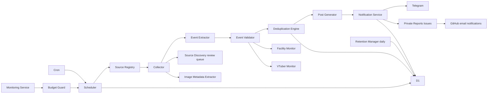

# 아키텍처

목표는 개인 서버 없이 월 추가 비용 0엔으로 공식 정보 기반 일본어 X 복사용 글을 전달하는 것이다. DEV00의15계약·도메인·스키마를 보존했다. DEV01은 분리된 staging/production과 D1 환경 식별, Health/Cron 진단, 안전한 조건부 배포를 추가했다. 원격 인증은 사용자 요청으로 보류되어 아직 Cloudflare에 배포하지 않았다.

## DEV01 진단 경계

GET/HEAD /health는 환경검증 후 D1의 singleton marker를 bind(1)로 조회한다. 변수의 환경·명칭과 실제 DB marker·schema2가 맞아야200이다. 잘못된설정/DB실패/환경혼동/3초대기초과는 안전한503 코드만 반환한다. 다른경로404·다른메서드405는 DB를 조회하지 않는다. 토큰/DB ID/계정/원문오류는 공개응답에 없다. 상세진단은 내부 구조화로그만 사용하며 관리 HTTP 엔드포인트는 만들지 않았다.

두 Cron은 같은 읽기전용 진단을 수행하고 실패시 실행을 실패로 표시한다. 수집·정리·알림·D1로그쓰기 작업은 호출하지 않는다. 계정전체 사용량 unknown은 최소진단1쿼리만 허용하며 사업처리/무제한수집을 허용하지 않는다. 로그에는 실행시각·성공/코드·요청/쿼리/rows_read/written·작업0·wallTimeMs를 기록한다. cpuTimeMs는 null이며 실제 Cloudflare metrics 없이 wall time을 CPU로 부르지 않는다. timeout은 대기만 종료하며 이미 실행중인 D1 쿼리를 취소한다고 보장하지 않는다.

staging/production은 각자 별도D1와 완전한 non-inherited vars를 사용한다. 양쪽collection/notifications는 false 강제이다. DB생성·마이그레이션·marker초기화와 배포는 분리하고 production 테스트삭제/자동복구는 금지한다. 상세 경계는 DEPLOYMENT·DISASTER_RECOVERY 참조. 이 기반 추가로 아래 DEV02~10 제품흐름은 변경하지 않았다.

15개 모듈의 주입 가능한 계약은 `src/contracts.ts`, 공통 값은 `src/domain.ts`가 기준이다. 네트워크, 파싱, 검증, 게시글 생성, 전달을 분리한다. 웹페이지 텍스트는 데이터이며 명령으로 실행하지 않는다. 유료 AI/API가 개입하지 않는다.

## 실행·순환

UTC `0 */3 * * *`로 하루8회 조사, `17 0 * * *`로 일일 정리(09:17 JST). 호출마다 작은 배치(초기 계획 1정보원)만 처리한다. 47개 현별 cursor와 category별 최소 할당을 유지하고, 미조사 대기시간에 가중치를 주어 VTuber/대형기관/수도권이 지역 소식을 밀어내지 않게 한다. 날짜·마감·최근변경은 그 안에서 우선한다. DEV08은 현별 최대 대기시간·소규모 비중을 보고하며 완주속도 SLA는 실측 전 약속하지 않는다.

D1 lease와 조건부 UPDATE로 중복 Cron 실행을 배제한다. 각 소스 처리 이후 cursor/next_crawl_at/run usage를 checkpoint한다. 만료된 lease 재획득으로 복구한다. 외부작업과 DB변경은 원자적이지 않으므로 outbox/lease/idempotency가 필요하다. 무료 CPU 초과로 강제중단되어도 마지막 checkpoint 이후 소스만 재시도한다.

ETag/Last-Modified/본문 digest로 변경 없는 문서 파싱을 줄인다. 공식 RSS/Atom→작은 HTML/사이트맵 순서; robots/약관 미검토 소스는 활성화하지 않는다. 타임아웃 초기계획 5초, 본문256KiB, 동시연결1, 재시도 최대1(실행 예산 내), 429 Retry-After를 준수해 다음 실행으로 연기한다. 모든 요청·리다이렉트·robots·전달이 예산을 소비한다. 복잡한 PDF/OCR·JS 렌더링은 지원검토 목록으로 격리한다.

## 검증과 변경

Evidence는 필드·공식URL·확인시각·짧은 근거를 기록한다. 불명확한 날짜/요금/예약을 추정하지 않는다. Verified만 PostGenerator 입력이다. DB 직접 접근의 검증도 DEV04/06에서 재확인한다. 시설 휴관은 영향 후보를 만들며 공식 행사 취소 근거 없이는 status=cancelled로 바꾸지 않는다. 정기휴관은 반복 알림에서 제외한다. 날짜 미확정/진행중 휴관은 자동 삭제하지 않는다.

연례행사는 기관/정규화 제목/일시/연도/회차를 함께 평가한다. URL만으로 동일행사 판정하지 않으며 애매한 유사성은 검토로 보낸다. stable_event_id는 내부 식별자, revision은 공식 변경 단위이다. 변경/마감 알림은 새 revision/kind 지문을 사용해 기존 게시를 덮어쓰지 않는다.

## 전달·복구

PostGenerator 길이는 DEV05에서 [X 공식 규칙](https://docs.x.com/fundamentals/counting-characters)과 [twitter-text v3 설정](https://github.com/twitter/twitter-text/blob/master/config/v3.json)을 재확인해 구현한다(2026-11-11 확인). 일반 게시 한도280 가중단위, 일본어 CJK/emoji는2, 감지된 URL은23, 해시태그는 # 포함 일반계산, NFC 정규화와 ZWJ emoji 처리를 적용한다. 단순 string.length로 대체하지 않는다. 공식 twitter-text 라이브러리/동일 conformance fixture를 평가하고 URL·해시태그 포함 최종문장을 검증한다. DEV00은 해당 계약만 제공한다.

Report에는 행사·검증·변경·게시상태·이미지권리·링크가 포함된다. Telegram은 관리/버튼 메시지, 복사용 일본어 메시지, 이미지 출처 메시지를 분리한다. callback은 짧은 서버측 opaque ID와 사용자/chat 검증·만료·단일처리를 사용한다. posted/held/recheck를 publication_records에 반영한다. posted만 중복게시 지문을 만든다.

전달키는 event/revision/channel/message_part로 고정한다. outbox pending→sending(lease)→sent; 발신후 응답 소실은 uncertain으로 두어 무조건 재전송하지 않는다. Telegram은 exactly-once를 보장하지 않으므로 uncertain은 재확인/운영 조정 대상이다. Issues는 저장된 issue/message ID를 갱신한다. Issues와 Telegram은 서로 입력 소스로 사용하지 않아 알림 루프를 막는다. 이메일은 GitHub 구독에 종속되며 별도 메일 발송 API는 없다.

Public에는 코드/합성fixture/정책만, Private에는 실제 행사보고/생성글/검증/게시이력을 둔다. D1은 운영 데이터 저장소이다. 배포/Secrets/D1 원격 생성은 DEV01, 실제 Telegram·Issues·메일은 DEV06에서 검증한다.
