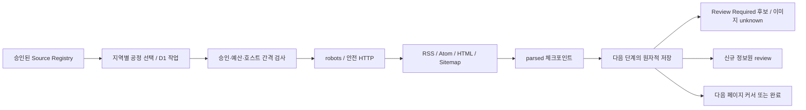

# DEV-03 수집 엔진

구현 기준일: 2026-11-12 JST. 범위는 로컬 수집·파싱·후보 추출이다. 검증된 Event, X 글, Telegram/Issues 전송을 생성하지 않는다. src/index.ts의 공개 Health/Cron은 읽기 전용 그대로이며 수집 엔진을 호출하지 않는다. production collection/notifications 및 배포 활성화 변수는 false다.

## 모듈과 단계

src/collection/http.ts는 Collector 계약을 구현하며 네트워크/상태/크기/인코딩/재시도를 담당한다. parse.ts 아래 HTML/XML 파서는 순수 데이터 처리이며 네트워크를 호출하지 않는다. discovery.ts는 기존 SourceDiscovery 계약의 별도 facade이고, orchestrator는 같은 발견 결과를 후보 저장과 원자적으로 기록한다. store.ts는 승인·검토·작업·관측 상태·후보/버전/이미지를 D1에 저장한다. meter.ts는 D1 제공 카운터와 API 호출/SQL statement 수를 구분한다.



한 step은 한 작업의 fetch+parse 또는 parsed 결과 저장만 수행한다. pending→fetching→parsed→completed/unchanged, 오류는 deferred/failed다. 기본 lease60초와 owner CAS가 경합/중단을 방어한다. 단계 처리 중 token이 바뀌면 INSERT/UPDATE의 owner 조건으로 오래된 작업자의 저장을 차단한다. 긴 Cron 장애/분산 lease 운용 완성은 DEV09다.

기본 본문 상한256KiB, 5초/요청, 전체 HTTP 단계30초, 요청8회, redirect3회, 일시 재시도1회, 동시 처리1개다. robots/redirect/retry도 요청 예산에 포함한다. 이미지/상세링크를 무조건 요청하지 않는다. 같은 호스트의 작업은 D1 gate로60초 예약하고 실제 요청 사이에는 승인된 gap(기본1초)을 지킨다. Source 사이클 최소간격은3600초 이상이다. Crawl-delay가 승인 gap보다 크면 sleep 대신 이월한다. 5초를 넘는 gap은 현재 실행 방식에서 승인하지 않는다.

## 커서·복구·원본 보관

페이지당 후보10개, 발견 링크20개, DOM/XML node10000개·중첩48단계다. 긴 목록은 nextOffset으로 이어서 처리한다. 완료하지 않은 문서는304/동일 지문 생략을 적용하지 않으며 다음 조각은 최소 조사간격 뒤 재요청한다. 본문이 바뀌면 커서를0으로 돌리고 후보 PK로 중복을 막는다. 안정된25항목 목록 완주와 변경 후26항목 재개를 테스트했다. 계속 바뀌는 큰 목록은 이전 항목 확인이 지연될 수 있으므로 안정적인 공식 pagination/RSS/전용 adapter가 필요하다. 완주 속도를 보장하지 않는다.

전체 HTML/XML 원문은 D1에 저장하지 않는다. parsed JSON만64KiB 이하로 임시 보관하며 후보 저장 완료 시 제거한다. DB 쓰기 실패는 원자적으로 rollback하고 parsed payload를 보존해 네트워크 재요청 없이 재개한다. 네트워크 성공 전 마지막 시도 시각을 먼저 기록하므로 프로세스가 중단돼도 Source 간격을 지킨다. 작업당 fetch claim은 최대3회이며 이후 수동 검토 재시도가 필요하다. 후보·Source·시설을 삭제해 복구하지 않는다.

Sitemap index는 depth1, 사이클당 자식 파일 최대3개다. 순환/중복 URL은 job key로 차단하고 그 외 링크는 review 후보로 남긴다. 모든 sitemap URL을 자동 방문하지 않는다. 지역 선택은 DEV02의47현 커서를 영속화하고 VTuber 예산을 분리한다. national/null 지역의 완전한 배정·전체47현 규모 최적화는 DEV08/09 범위이며 수집 API에는 null 지역 Source도 명시적으로 enqueue할 수 있다.

## 로컬 관리

```powershell
. ./scripts/environment.ps1
npm run seed:init
npm run seed:import -- --apply
npm run collector:status
npm run collector:review -- --file data/collection-reviews/naoj.json
npm run collector:review -- --file data/collection-reviews/naoj.json --apply
npm run collector:run -- --apply
```

전용 E cache/registry/staging만 사용하며 production/--remote는 거부한다. review/approve는 기본 Dry Run, 변경에는 --apply가 필요하다. approve는 공식 주체/정확한 URL/robots 지문 또는404 허용 근거/약관 결정·근거/유효기간/허용 경로·호스트/파서·간격/성공한 시험 근거를 모두 요구한다. 사람이 검토한 증거를 검증하는 도구이며 법률 해석이나 시험 결과를 자동 생성하지 않는다. 이번 실제 승인은0이다. 미승인 Source의 실전 시험을 위해 gate를 우회하지 않았다.

run-one은 active0이면 요청0으로 끝난다. 승인 후 실제 로컬 네트워크 시험에는 별도 --local-budget가 필요하다. 이 옵션의0 사용량은 Cloudflare 미사용 로컬 실행을 뜻하며 계정 전체 여유 증명이 아니다. Workers의 기본 전송기는 DNS/peer 보장 미확인으로 차단된다. [SSRF 감사](SSRF_SECURITY_AUDIT.md)를 따른다. review/unsupported 재심사는 원자적으로 Source를 비활성 상태로 바꾸며 이전 승인 기록은 감사용으로 보존한다.

DEV04는 CollectionStore.listForVerification의 최대50행 커서 페이지로 후보를 읽는다. 날짜/요금/예약/취소/시설 영향/이미지 권리는 그 단계에서 검증한다. 변경된 후보는 Review Required로 되돌리고 이전 지문별 관측 버전을 보존한다. 실제 events/generated_posts/notification_deliveries에는 쓰지 않는다.

## DEV04 검증 신선도 통합

collection_documents.changed_at은 실제본문 digest 변경시각이다. 같은본문의 다음pagination/checkpoint·304는 성공/시도시각만 바꾸고 changed_at을 이동시키지 않는다. DEV04는 이 시각보다 전에만 관측된 과거후보를 보류하므로 정상첫페이지 후보를 불필요하게 무효화하지 않도록 nativeD1 회귀로 연결한다.
